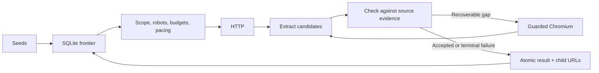

# Architecture

Prism's supported product path is adaptive retrieval: try HTTP and source-derived structured candidates, then use one guarded browser attempt when verification detects a recoverable content gap. Older HTTP-only and render-first modes remain hidden compatibility options for research.

## Ownership and request flow

`CrawlConfig` owns budgets, origin scope and optional decision settings. `Crawler` owns bounded workers and run lifecycle. `Network` owns policy, robots caches, scheduling and all website traffic. `Extractor` returns candidate text taken from a received source. `ContentVerifier` checks detectable gaps against source headings, blocks, deferred content and target identity. `Store` owns durable state.

Workers claim a queued URL while respecting one active page per origin. HTTP fetches enforce origin scope, public-address resolution, robots, byte/time/request budgets, redirects, retries and pacing. Robots unavailability is a distinct refusal. A repeated redirect URL terminates its chain immediately. Explicit access restrictions are terminal outcomes.

Accepted candidates carry extraction and verification metadata. Weak extraction can try an explicitly advertised structured alternative, followed by at most one browser attempt. Chromium reuses a process but isolates page contexts. CDP Fetch routes requests through the same guarded transport; a deny-only local proxy prevents uninstrumented targets from gaining native egress. Browser assets have a separately bounded per-origin concurrency lane. Document requests remain serialized per origin. Both lanes share errors, cooldowns, robots and global budgets.

A browser can finish when verified content stabilizes; unrelated background traffic need not exhaust the page deadline. Scripts, styles, bounded scrolling and open shadow roots are supported. Unlisted dependencies, POST requests, cookies, authentication, service workers and access-wall handling are outside the supported path. These restrictions trade compatibility for explicit behavior.

## Durable frontier

SQLite WAL stores runs, frontier leases, results, persistent pages, duplicate fingerprints, route observations, request receipts and attempts. A process lock permits one writer per database. Multiple workers run inside that process.

The worker gathers and scope-validates discovered child URLs before recording a page. `Store.record` writes the page, deduplication state, result, completed lease and child frontier rows in one transaction. A crash before commit leaves the lease recoverable; a crash after commit leaves its children queued. Failed child insertion rolls back page completion. Resume requires the original configuration and seeds and requeues abandoned leases.

The load harness kills actual subprocesses during requests and immediately after the record transaction returns. Its origin-side ledger distinguishes repeated requests from duplicate stored results. Delivery is at-least-once for networking, with one result per URL/run. This is not a power-failure durability proof.

## Content and quality

HTML candidates include semantic containers, boilerplate removal, JSON-LD, hydration fields and a narrowly detected undecorated CMS prose layout. Section/card headers preserve real headings. Textual JSON, feeds, bounded sitemaps and bounded text PDFs are supported. Exact hashes and indexed 64-bit SimHash bands annotate duplicates; they do not delete extracted records.

Verification is a bounded heuristic. It checks source heading/block coverage, loading markers, truncation and lost target identifiers. Extraction and verification share some cleanup semantics, so agreement does not establish correctness. The source/output audit caught failures that keyword tests and internal checks both missed. Published evaluation separates those checks from reviewed content quality.

## Adaptation

The router persists method success and elapsed time by origin/path pattern, expires stale observations and periodically retries HTTP. Optional local model adapters can classify existing candidates and advise bounded fallback. Models cannot generate saved text or override access policy. Deterministic routing is the measured default.

Revisit intervals respond to observed change: unchanged content lengthens the interval and changed content shortens it, within bounds. Conditional requests apply only when validators match the saved representation. Rendered pages are revisited. This heuristic does not predict unseen changes between visits.

## Scope of the design

SQLite and a single process make setup and crash experiments reproducible on one machine. There is no distributed queue, object store, multi-tenant API, cluster scheduler or demonstrated million-page capacity. The [evaluation](evaluation.md) reports exactly which workloads were measured; [limits](limits.md) lists unsupported behavior. Historical strategy/provider research remains in the benchmark tools and older notes, outside the main product path.
